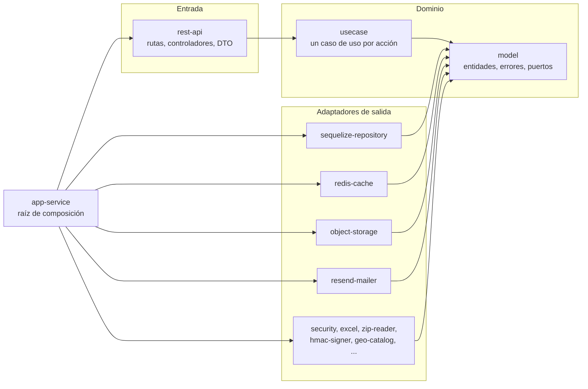

# Earthcation API

API de Earthcation, un Juego Serio para reforzar la identificación de riesgos en la labor minera subterránea de
carbón en Norte de Santander. Es la fuente de verdad de la plataforma: la consumen el juego (Unity, WebGL), el panel
web (`earthcation_fe`) y el Worker que sirve el juego (`earthcation_play`).

Proyecto del Semillero VIRAL de la Universidad Francisco de Paula Santander (UFPS), desarrollado como trabajo de grado
de Ingeniería de Sistemas.

## Contenido

1. [Qué hace](#qué-hace)
2. [Arquitectura](#arquitectura)
3. [Requisitos y puesta en marcha](#requisitos-y-puesta-en-marcha)
4. [Configuración](#configuración)
5. [Documentación de la API](#documentación-de-la-api)
6. [Pruebas y calidad](#pruebas-y-calidad)
7. [Despliegue](#despliegue)
8. [Decisiones de diseño](#decisiones-de-diseño)
9. [Cómo contribuir](#cómo-contribuir)

## Qué hace

| Contexto | Responsabilidad |
|---|---|
| Identidad | Inicio de sesión por cédula (jugadores) o cédula y contraseña (personal), usuarios, roles, restablecimiento de contraseña e importación masiva desde la planilla de la ANM |
| Catálogo | Organizaciones y localidades (catálogo cerrado de municipios de Colombia) |
| VARK | Test de estilo de aprendizaje del jugador y sus listados para el panel |
| Sesiones | Salas de capacitación con código de 3 dígitos, inscripción, inicio y cierre, detalle por participante, análisis individual e informe en Excel |
| Aprendizaje | Intentos de nivel, eventos de telemetría, resultados por riesgo, niveles y analíticas |
| Despliegue | Versiones del build WebGL: subida, validación, publicación en R2, vista previa firmada y activación |
| Auditoría | Registro de solo inserción de las acciones sensibles del personal: quién, qué, sobre qué y desde dónde (huella de la IP). Consulta y exportación CSV para admin y desarrollador |
| Observabilidad | Visitas al juego (las reporta el Worker), salud del servicio y métricas |

Reglas que se cumplen en toda la API: los registros no se borran, se deshabilitan (`isActive`) para conservar el
histórico de progreso; la contraseña de un usuario nuevo la genera el servidor y llega por correo; el jugador entra
solo con la cédula.

## Arquitectura

Arquitectura limpia (hexagonal) en un monorepo `pnpm` con `Turborepo`. Cada capa y cada adaptador es un paquete con su
propio `package.json`, así que pnpm impide importar lo que un paquete no declaró, y `dependency-cruiser` impide
declarar lo que no corresponde.



```
domain/
  model/                      @earthcation/model     entidades, value objects, errores de dominio y puertos (gateways)
  usecase/                    @earthcation/usecase   un XxxUseCase.execute(cmd) por acción, agrupados por contexto
infrastructure/
  driven-adapters/            implementan los puertos del dominio
    sequelize-repository/     PostgreSQL: modelos, migraciones (Umzug), repositorios y lecturas
    redis-cache/              caché y contadores de límite de peticiones (Redis, con respaldo en memoria)
    object-storage/           S3 (originales), R2 (publicados) y disco local
    security/                 bcrypt y JWT (HS256)
    resend-mailer/            correos (Resend)
    excel/                    informe de sesión (ExcelJS) y lector de la planilla ANM
    zip-reader/  hmac-signer/  in-process-queue/  in-memory-metrics/  geo-catalog/
  entry-points/
    rest-api/                 Express: createApp, rutas legacy y v1, validación, errores, OpenAPI
applications/
  app-service/                único desplegable: config/env.ts, container.ts (inyección manual), boot.ts, main.ts
```

Reglas del grafo de dependencias: `model` no depende de nada, `usecase` solo de `model`, los adaptadores de `model` y su
librería, `rest-api` de `usecase` y `model`, y `app-service` de todos. Un caso de uso no llama a otro: lo compartido
vive en servicios de dominio dentro de `model`. Los errores son subclases de `DomainError` con un `code` estable, y un
único manejador de errores los traduce a HTTP.

## Requisitos y puesta en marcha

- Node 22 o superior
- pnpm 9 (la versión exacta está en `packageManager`; con Corepack: `corepack enable`)
- PostgreSQL 16 o superior (el CI usa 16 y producción 18)

```bash
pnpm install
cp .env.test.example .env.test      # base de datos de PRUEBAS, ver más abajo
```

Para correr la API en local crea un archivo `.env` con al menos estas variables (ver la tabla de configuración):

```bash
# Genera uno con: openssl rand -hex 32
JWT_SECRET=<tu-secreto-de-al-menos-32-caracteres>
DB_HOST=localhost
DB_PORT=5432
DB_NAME=earthcation_dev
DB_USER=postgres
DB_PASS=<tu-clave-local>
FRONTEND_URL=http://localhost:5173
```

```bash
createdb earthcation_dev            # una vez
pnpm build
pnpm start                          # o: pnpm dev, con recarga
```

Al arrancar, la API aplica las migraciones pendientes, deja como fallidas las publicaciones que quedaron cortadas por
un reinicio y siembra el catálogo de municipios (idempotente). Para comprobarla:

```bash
curl http://localhost:3000/api/v1/health
```

El archivo `.env` nunca se versiona. Usa siempre una base de datos de desarrollo propia: las pruebas borran y recrean
su esquema.

## Configuración

Todas las variables se validan al arrancar en `applications/app-service/src/config/env.ts`, el único lugar del código
que lee `process.env`. Si falta una obligatoria la API no arranca y lo dice.

| Variable | Obligatoria | Por defecto | Para qué sirve |
|---|---|---|---|
| `JWT_SECRET` | Sí | | Firma de los tokens; mínimo 32 caracteres |
| `DB_HOST` `DB_PORT` `DB_NAME` `DB_USER` `DB_PASS` | Sí | puerto 5432 | Conexión a PostgreSQL (TLS activo en producción) |
| `DB_POOL_MAX` `DB_POOL_MIN` | No | 20 y 2 | Conexiones del pool |
| `DB_SSL_CA` | No | | Certificado de la CA del servidor de base de datos (PEM). Con él la conexión TLS verifica el certificado; sin él solo se cifra |
| `PORT` | No | 3000 | Puerto HTTP |
| `ALLOWED_ORIGINS` | No | en producción, `FRONTEND_URL` y `PLAY_URL`; en desarrollo, cualquiera | Orígenes CORS separados por coma. En producción nunca se acepta cualquiera |
| `FRONTEND_URL` | Para correos | | Base del enlace para definir o restablecer la contraseña |
| `RESEND_API_KEY` `EMAIL_FROM` | Para correos | `noreply@saimers.dev` | Envío de correos; sin clave la API arranca pero los envíos fallan |
| `REDIS_URL` | No | memoria | Caché y límites de peticiones compartidos entre instancias |
| `VISITS_INGEST_SECRET` | Para visitas | | Secreto compartido con el Worker; sin él la ingesta responde 401 |
| `CF_EDGE_SECRET` | En Cloudflare | | Valor de `x-earthcation-edge` que agrega la regla de transformación; permite confiar en la IP del visitante |
| `PLAY_URL` `PLAY_SIGNING_SECRET` | Para despliegue | | Dominio del juego y secreto compartido con el Worker para las vistas previas |
| `AWS_S3_BUCKET` `AWS_REGION` `AWS_ACCESS_KEY_ID` `AWS_SECRET_ACCESS_KEY` | No | disco local | Originales de las versiones (subida directa del navegador con URL prefirmada) |
| `R2_BUCKET` `R2_ACCOUNT_ID` `R2_ACCESS_KEY_ID` `R2_SECRET_ACCESS_KEY` | No | disco local | Versiones publicadas que sirve el Worker |
| `DEPLOY_MAX_MB` `DEPLOY_LOCAL_DIR` | No | 500 y `.deploy` | Tope de tamaño del ZIP y carpeta local sin S3 ni R2 |
| `RATE_LIMIT_USER_MAX` `RATE_LIMIT_IP_MAX` `RATE_LIMIT_AUTH_MAX` | No | 1500, 3000 y 300 | Peticiones por 15 minutos: por usuario con token, por IP anónima y en login |
| `RATE_LIMIT_LOGIN_CEDULA_MAX` `RATE_LIMIT_LOGIN_IP_FAIL_MAX` | No | 10 y 60 | Intentos de login fallidos por cédula y por IP |
| `RATE_LIMIT_JOIN_MAX` | No | 20 | Intentos por jugador (cada 15 minutos) de unirse a una sala o validar un código, para que un código de 3 dígitos no se pueda adivinar |
| `SCOPED_READS` | No | `true` | Lecturas acotadas: el instructor solo lee a los jugadores de sus salas y el desarrollador no ve datos personales ni exporta el Excel. `false` la apaga |
| `AUDIT_IP_SALT` | No | derivada de `JWT_SECRET` | Sal de las huellas de IP del registro de auditoría (la IP nunca se guarda) |
| `DOCS_ACCESS` | No | `public` | `staff` exige token de admin o desarrollador para ver la documentación |

## Documentación de la API

Hay dos APIs conviviendo:

- **v1** (`/api/v1`): la API nueva. Un sobre `{ data, meta }`, errores `{ error: { code, message, details } }`, JSON en
  camelCase, fechas ISO 8601, ids UUID validados, listados con `?page=&limit=&sort=-campo` y reglas de negocio con
  código 422. Se documenta sola con OpenAPI 3.1:
  - Swagger UI: `/api/v1/docs`
  - Especificación: `/api/v1/openapi.json`
- **legacy** (`/api/...` sin versión): la API original que todavía usan el panel y las versiones del juego ya
  publicadas. No cambia y se retirará cuando ningún cliente la llame.

Cada ruta de v1 se define una sola vez (`route({ method, path, roles, params, query, body, response, handler })`) y de
esa definición salen el router de Express, la validación con zod y el documento OpenAPI, de modo que la documentación
no puede quedar desactualizada respecto del código.

Autenticación: `Authorization: Bearer <token>`, con el token que devuelve `POST /api/v1/auth/login`. Los roles son
`player`, `instructor`, `admin` y `developer`. La guía de la telemetría del juego está en
[`docs/TELEMETRY.md`](./docs/TELEMETRY.md).

## Pruebas y calidad

```bash
pnpm build          # compila todos los paquetes en orden de dependencias (Turborepo)
pnpm lint           # ESLint estricto con tipos: funciones de máximo 10 líneas, complejidad 5, 3 parámetros
pnpm boundaries     # dependency-cruiser: límites entre capas
pnpm test           # Vitest por paquete
```

| Nivel | Dónde | Qué comprueba |
|---|---|---|
| Unitarias del dominio | `domain/model/test` | Entidades, value objects y reglas puras |
| Casos de uso | `domain/usecase/test` | Cada caso con puertos falsos en memoria, sin base de datos |
| Entrada HTTP | `infrastructure/entry-points/rest-api/test` | Sobre, errores, validación, paginación, OpenAPI y límites de peticiones |
| Contrato | `applications/app-service/test/contract` | Rutas legacy y v1 contra PostgreSQL real, con una semilla fija |

Las pruebas de contrato de la API legacy guardan instantáneas de la forma de cada respuesta por rol; mientras la API
legacy exista esas instantáneas no deben cambiar. Necesitan una base de datos de pruebas: copia `.env.test.example`
como `.env.test` (el nombre de la base **debe contener** `test`: las pruebas borran y recrean el esquema).

La carga de un salón de 50 jugadores se puede simular con
`applications/app-service/scripts/load/simulate-players.js` (solo contra una base de pruebas).

El CI (`.github/workflows/ci.yml`) corre en cada pull request y en cada push a `develop` y `main`: instala con el
lockfile, compila, carga la app sin base de datos, comprueba los límites entre capas, corre lint y pruebas con un
PostgreSQL 16 de servicio, y escanea secretos con gitleaks.

## Despliegue

Railway despliega la rama `main` cuando el CI está en verde. Detecta pnpm por `packageManager` y el lockfile,
construye con `pnpm build` y arranca con `pnpm start` (`node applications/app-service/dist/main.js`). Para publicar:

1. Abrir `release/vX.Y.Z` desde `develop`, subir la versión en `package.json` y en
   `applications/app-service/package.json` (la versión que informa `/api/v1/health`) y actualizar `CHANGELOG.md`.
2. Fusionar en `main` por pull request, poner el tag `vX.Y.Z` y sincronizar `main` en `develop`.
3. Verificar `GET /api/v1/health` en producción.

El esquema de la base de datos cambia solo por migraciones versionadas (Umzug, tabla `schema_migrations`): cambiar un
modelo no cambia la base. Una migración nueva es un archivo `00NN_descripcion.ts` en
`infrastructure/driven-adapters/sequelize-repository/src/migrations`.

## Decisiones de diseño

- **Clases y excepciones tipadas, no `Result`.** Los casos de uso lanzan subclases de `DomainError` con un `code`
  estable; un único manejador las traduce a HTTP. Se mantiene el estilo de capas explícitas, comprensible para quien
  conoce arquitectura hexagonal en Java.
- **Dos versiones de la API.** v1 se construye al lado de la API legacy sin tocarla, porque el panel y las builds ya
  publicadas del juego dependen de ella. Cuando los clientes migren, legacy se borra.
- **El esquema OpenAPI sale de zod.** Una sola definición valida la entrada, tipa el handler y documenta la ruta.
- **El dominio no conoce el ORM.** Sequelize vive solo en `sequelize-repository`: los repositorios traducen filas a
  entidades y el dominio solo ve puertos.
- **Límites de peticiones pensados para un salón.** Un grupo entero comparte una IP pública, así que las peticiones con
  token cuentan por usuario y solo las anónimas por IP. En el login solo cuentan los intentos fallidos.
- **Nada se borra.** Usuarios, organizaciones, localidades y versiones se deshabilitan para no perder el histórico
  del progreso.

## Cómo contribuir

El flujo de trabajo (git flow, convención de commits y lista de comprobación del pull request) está en
[`CONTRIBUTING.md`](./CONTRIBUTING.md). Las particularidades del código que importan al editarlo están en
[`CLAUDE.md`](./CLAUDE.md).
